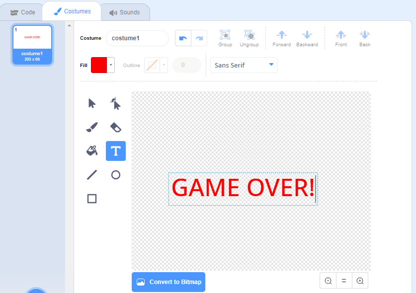

## Game over

Next, you're going to add a 'game over' message at the end of the game.

--- task ---

If you haven't already, create a new variable called `lives`{:class="block3variables"} **for all sprites**. Tick its checkbox so the player can see it.

On the **Stage**, start a new script to reset the lives when the green flag is clicked. If you added lives in the earlier challenge, update your existing script instead.

```blocks3
when flag clicked
set [lives v] to (3)
```

--- /task ---

--- task ---

On the **Spaceship** sprite, update the collision script you made earlier. Add `change lives by -1`{:class="block3variables"} after the `hit`{:class="block3events"} broadcast. Keep the one-second pause so each collision costs one life. If you already added this block in the challenge, keep just one copy.

```blocks3
when flag clicked
forever
switch costume to (normal v)
wait until <<touching (Hippo1 v)?> or <touching (Orange v)?>>
switch costume to (hit v)
broadcast (hit v)
+change [lives v] by (-1)
wait (1) seconds
end
```

Test your game. It should start with three lives and lose one life when the spaceship is hit.

--- /task ---

--- task ---

Draw a new sprite called `Game Over` using the **text** tool.



--- /task ---

--- task ---

On the **Stage**, extend your lives setup script. Wait until there are no lives left, broadcast `game over`{:class="block3events"} and wait, then stop all scripts.


```blocks3
when flag clicked
set [lives v] to (3)
+wait until <(lives) < (1)>
+broadcast (game over v) and wait
+stop [all v]
```

--- /task ---

--- task ---

Add this code to your `Game Over` sprite so that it shows at the end of the game:


```blocks3
when flag clicked
hide

when I receive [game over v]
show
```

Because you've used a `broadcast (game over) and wait`{:class="block3events"} block on your Stage, the Stage will wait for the `Game Over` sprite to be displayed before ending the game.

--- /task ---

--- task ---

Test your game. After three collisions, the Game Over sprite should appear and everything should stop. Click the green flag to check that lives reset to three and the message disappears. If you added a score in the challenge, how many points can you score?

--- /task ---
